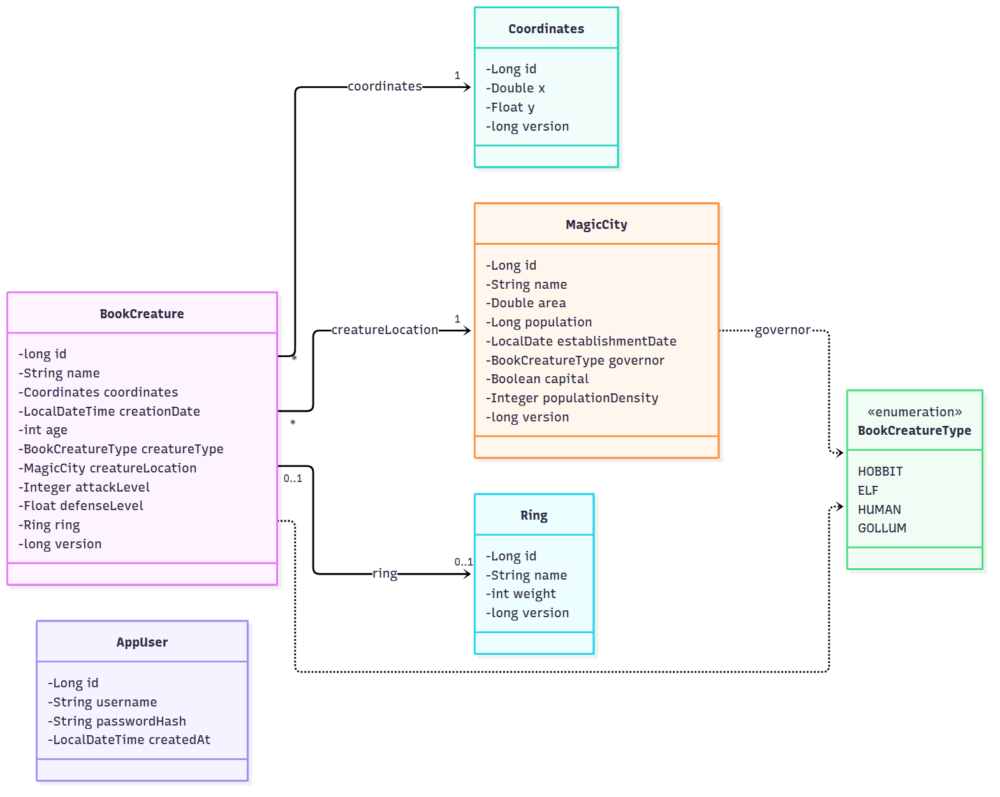
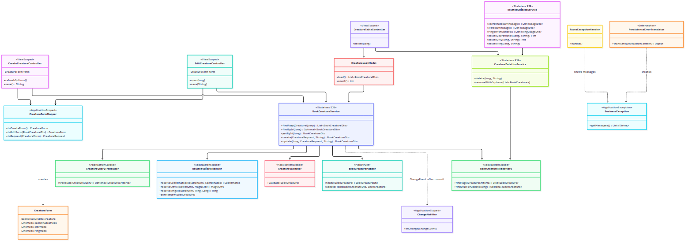
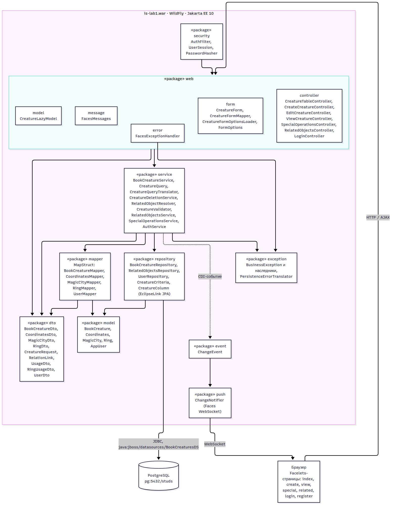

# Отчет по лабораторной работе №1
## «Информационные системы»

## 1. Текст задания

Реализовать информационную систему, которая позволяет взаимодействовать с объектами класса BookCreature, описание которого приведено ниже:

```java
public class BookCreature {
    private long id; //Значение поля должно быть больше 0, Значение этого поля должно быть уникальным, Значение этого поля должно генерироваться автоматически
    private String name; //Поле не может быть null, Строка не может быть пустой
    private Coordinates coordinates; //Поле не может быть null
    private java.time.LocalDateTime creationDate; //Поле не может быть null, Значение этого поля должно генерироваться автоматически
    private int age; //Значение поля должно быть больше 0
    private BookCreatureType creatureType; //Поле не может быть null
    private MagicCity creatureLocation; //Поле не может быть null
    private Integer attackLevel; //Значение поля должно быть больше 0, Поле может быть null
    private Float defenseLevel; //Значение поля должно быть больше 0, Поле может быть null
    private Ring ring; //Поле может быть null
}
public class Coordinates {
    private Double x; //Поле не может быть null
    private Float y; //Поле не может быть null
}
public class MagicCity {
    private String name; //Поле не может быть null, Строка не может быть пустой
    private Double area; //Значение поля должно быть больше 0, Поле не может быть null
    private Long population; //Значение поля должно быть больше 0, Поле не может быть null
    private java.time.LocalDate establishmentDate;
    private BookCreatureType governor; //Поле не может быть null
    private Boolean capital; //Поле не может быть null
    private Integer populationDensity; //Значение поля должно быть больше 0
}
public class Ring {
    private String name; //Поле не может быть null, Строка не может быть пустой
    private int weight; //Значение поля должно быть больше 0
}
public enum BookCreatureType {
    HOBBIT,
    ELF,
    HUMAN,
    GOLLUM;
}
```

Разработанная система должна удовлетворять следующим требованиям:

Основное назначение информационной системы - управление объектами, созданными на основе заданного в варианте класса.
Необходимо, чтобы с помощью системы можно было выполнить следующие операции с объектами: создание нового объекта, получение информации об объекте по ИД, обновление объекта (модификация его атрибутов), удаление объекта. Операции должны осуществляться в отдельных окнах (интерфейсах) приложения. При получении информации об объекте класса должна также выводиться информация о связанных с ним объектах.
При создании объекта класса необходимо дать пользователю возможность связать новый объект с объектами вспомогательных классов, которые могут быть связаны с созданным объектом и уже есть в системе.
Выполнение операций по управлению объектами должно осуществляться на серверной части (не на клиенте), изменения должны синхронизироваться с базой данных.
На главном экране системы должен выводиться список текущих объетов в виде таблицы (каждый атрибут объекта - отдельная колонка в таблице). При отображении таблицы должна использоваться пагинация (если все объекты не помещаются на одном экране).
Нужно обеспечить возможность фильтровать/сортировать строки таблицы, которые показывают объекты (по значениям любой из строковых колонок). Фильтрация элементов должна производиться только по полному совпадению.
Переход к обновлению (модификации) объекта должен быть возможен из таблицы с общим списком объектов и из области с визуализацией объекта (при ее реализации).
При добавлении/удалении/изменении объекта, он должен автоматически появиться/исчезнуть/измениться в интерфейсах у других пользователей, авторизованных в системе.
Если при удалении объекта с ним связан другой объект, связанные объекты должны удаляться.
Пользователи должны иметь возможность просмотра всех объектов. Для модификации объекта должно открываться отдельное диалоговое окно. При вводе некорректных значений в поля объекта должны появляться информативные сообщения о соответствующих ошибках.
В системе должен быть реализован отдельный пользовательский интерфейс для выполнения специальных операций над объектами:

Рассчитать среднее значение поля attackLevel для всех объектов.
Вернуть количество объектов, значение поля defenseLevel которых меньше заданного.
Вернуть количество объектов, значение поля defenseLevel которых больше заданного.
Совершить обмен кольцами (указать id персонажей).
Найти персонажа с самым сильным кольцом.
Представленные операции должны быть реализованы в рамках компонентов бизнес-логики приложения без прямого использования функций и процедур БД.

Особенности хранения объектов, которые должны быть реализованы в системе:

Организовать хранение данных об объектах в реляционной СУБД (PostgreSQL). Каждый объект, с которым работает ИС, должен быть сохранен в базе данных.
Все требования к полям класса (указанные в виде комментариев к описанию классов) должны быть выполнены на уровне ORM и БД.
Для генерации поля id использовать средства базы данных.
Для подключения к БД на кафедральном сервере использовать хост pg, имя базы данных - studs, имя пользователя/пароль совпадают с таковыми для подключения к серверу.
При создании системы нужно учитывать следующие особенности организации взаимодействия с пользователем:

Система должна реагировать на некорректный пользовательский ввод, ограничивая ввод недопустимых значений и информируя пользователей о причине ошибки.
Переходы между различными логически обособленными частями системы должны осуществляться с помощью меню.
При добавлении/удалении/изменении объекта, он должен автоматически появиться/исчезнуть/измениться на области у всех других клиентов.
При разработке ИС должны учитываться следующие требования:

В качестве основы для реализации ИС необходимо использовать Java EE, Managed Beans.
Для создания уровня хранения необходимо использовать EclipseLink.
Разные уровни приложения должны быть отделены друг от друга, разные логические части ИС должны находиться в отдельных компонентах.
Содержание отчета:

Текст задания.
UML-диаграммы классов и пакетов разработанного приложения.
Исходный код системы или ссылка на репозиторий с исходным кодом.
Выводы по работе.

## 2. UML-диаграммы

### 2.1 Диаграмма классов модели



### 2.2 Диаграмма классов приложения (бизнес-логика, хранение, представление)



### 2.3 Диаграмма пакетов



## 3. Исходный код

Стек: Java 17, Jakarta EE 10 (JSF 4.0, CDI, EJB, JPA 3.1, Bean Validation), PrimeFaces 12,
EclipseLink 4.0.2, MapStruct 1.6, PostgreSQL, WildFly 38, Maven.

Кратко об архитектуре:

- **model** — JPA-сущности `BookCreature`, `Coordinates`, `MagicCity`, `Ring`, `AppUser`. Ограничения задания
  заданы аннотациями Bean Validation и атрибутами `@Column/@JoinColumn`.
- **domain** — перечисление `BookCreatureType`, общее для сущностей и DTO.
- **dto** — объекты передачи данных между веб-слоем и сервисами (`BookCreatureDto`, `CoordinatesDto`,
  `MagicCityDto`, `RingDto`, `CreatureRequest`, `RelationLink`, `UsageDto`, `RingUsageDto`, `UserDto`).
  Веб-слой работает только с ними и не зависит от JPA.
- **mapper** — преобразование сущностей в DTO и обратно на MapStruct; реализации генерируются при компиляции,
  в CDI мапперы попадают через `MapperProducer`.
- **exception** — иерархия исключений бизнес-логики (`NotFoundException`, `ValidationException`,
  `ConflictException`, `DataIntegrityException`, `AuthenticationException`) и интерцептор
  `PersistenceErrorTranslator`, который переводит ошибки JPA/SQL в эти типы.
- **repository** — доступ к данным через EclipseLink (`EntityManager`, JPQL). Сортировка и фильтрация
  таблицы выполняются в БД по перечислению `CreatureColumn` (`CreatureCriteria`). Связанные объекты
  списков подгружаются пакетно (batch fetch), количества считаются запросами с `GROUP BY`, поэтому
  число SQL-запросов не зависит от количества строк (нет проблемы N+1).
- **service** — Stateless EJB с бизнес-логикой, каждая операция выполняется в JTA-транзакции:
  `BookCreatureService` (чтение, создание, изменение), `CreatureQuery` и `CreatureQueryTranslator`
  (параметры таблицы от веб-слоя и их перевод в критерии репозитория),
  `CreatureDeletionService` (удаление с orphan cleanup),
  `RelatedObjectResolver` (выбор или создание координат, города и кольца), `CreatureValidator`,
  `RelatedObjectsService`, `SpecialOperationsService`, `AuthService`.
- **event** и **push** — после успешного коммита публикуется CDI-событие `ChangeEvent` (тип, id, автор),
  `ChangeNotifier` рассылает его всем клиентам через Jakarta Faces WebSocket. Текст уведомления
  формирует фронтенд (`resources/js/app.js`).
- **security** — фильтр авторизации, сессия пользователя, хэширование паролей PBKDF2.
- **web** — `controller` (CDI-контроллеры страниц), `form` (состояние формы объекта, `CreatureFormMapper`
  для преобразования DTO в форму и формы в запрос, загрузка вариантов выбора),
  `model` (PrimeFaces `LazyDataModel`), `error` (единый `FacesExceptionHandler`), `message` (вывод сообщений).
  Контроллеры не перехватывают исключения: их показывает единый обработчик, неожиданные ошибки
  логируются с кодом инцидента.
- **БД** — схема создается при деплое скриптом с ограничениями `NOT NULL`, `CHECK`, `FOREIGN KEY`,
  `UNIQUE` (`db/schema.sql`); `id` генерирует PostgreSQL (`GENERATED BY DEFAULT AS IDENTITY`).
- Для shared `Coordinates`, `MagicCity` и `Ring` используются version-поля для optimistic locking при изменении;
  при удалении координаты, город и кольцо блокируются (`SELECT ... FOR UPDATE`) до конца транзакции, чтобы параллельное создание персонажа не ссылалось на удаляемый объект.
- В операции «самое сильное кольцо» сила, как `Ring.weight`. При равном весе выбирается меньший `BookCreature.id`.


## Что реализовано

| Требование задания | Где в коде                                                                                                                                          |
|---|-----------------------------------------------------------------------------------------------------------------------------------------------------|
| CRUD объектов в отдельных окнах | `create.xhtml` (создание), `view.xhtml` (по ID и связанные объекты), диалог `WEB-INF/includes/edit-dialog.xhtml` (изменение), удаление с подтверждением |
| Связь с существующими координатами, городом, кольцом | `creature-form.xhtml` Создать Выбрать Изменить                                                                                                      |
| Операции на сервере, синхронизация с БД | EJB `service/*Service` (JTA-транзакции) → `repository/*` (EclipseLink)                                                                              |
| Таблица, пагинация, сортировка, фильтр по полному совпадению | `index.xhtml` + `web/model/CreatureLazyModel` → `BookCreatureRepository.findPage` (все на сервере, JPQL)                                                  |
| Изменение из таблицы и из визуализации объекта | кнопка карандаш в таблице и Изменить на `view.xhtml`                                                                                                |
| Автообновление у других пользователей | `push/ChangeNotifier` (Jakarta Faces WebSocket, `f:websocket`) после коммита транзакции                                                             |
| Каскадное удаление связанных объектов | `CreatureDeletionService.removeWithOrphans`, `RelatedObjectsService`, FK `ON DELETE CASCADE`                                                            |
| Информативные ошибки ввода | Bean Validation на сущностях, `ValidationException` и `web/error/FacesExceptionHandler`; `p:inputNumber` не дает ввести буквы                                                                                |
| Спецоперации | `special.xhtml` → `SpecialOperationsService`                                                                                                        |
| Ограничения на уровне ORM и БД | аннотации в `model/*` + `CHECK/NOT NULL/FK` в `META-INF/sql/create.sql` (читаемая версия: `db/schema.sql`)                                          |
| id генерирует БД | `GENERATED BY DEFAULT AS IDENTITY` + `@GeneratedValue(IDENTITY)`                                                                                    |
| Меню | `p:menubar` в `WEB-INF/templates/layout.xhtml`                                                                                                      |
| Авторизация | `login.xhtml` / `register.xhtml`, `security/AuthFilter`, пароли PBKDF2                                                                              |


## Структура

```
src/main/java/ru/itmo/is/lab1/
  model/            JPA-сущности и Bean Validation
  domain/           общие перечисления
  dto/              DTO для обмена между веб-слоем и сервисами
  mapper/           MapStruct-мапперы сущность <-> DTO
  exception/        исключения бизнес-логики и перевод ошибок JPA/SQL
  repository/       доступ к БД через EclipseLink
  service/          бизнес-логика, Stateless EJB, транзакции
  event/            событие изменения данных
  push/             рассылка изменений по WebSocket
  security/         фильтр авторизации, сессия, хэширование паролей
  web/controller/   контроллеры страниц (CDI)
  web/form/         форма объекта, её маппер и варианты выбора
  web/model/        LazyDataModel для таблицы
  web/error/        единый обработчик исключений JSF
  web/message/      вывод сообщений на страницу
src/main/resources/META-INF/
  persistence.xml        EclipseLink 
src/main/resources/messages.properties   подписи для страниц (например, способы выбора связанного объекта)
  sql/create.sql         DDL, выполняется при деплое
src/main/webapp/         Facelets-страницы, шаблон, CSS/JS
wildfly/setup.cli        настройка драйвера PostgreSQL и источника данных в WildFly
deploy/                  скрипты для helios
db/schema.sql            схема БД 
docs/uml/                UML-диаграммы классов и пакетов 
```

## Требования к окружению

- JDK 17 и Maven.
- WildFly 38 с настроенным JDBC-драйвером PostgreSQL и источником данных `java:jboss/datasources/BookCreaturesDS`.
- Доступ к PostgreSQL и действительные учетные данные БД.
- Для развертывания на helios — SSH-доступ к серверу.


## Запуск на helios

Ниже `s******` - логин, SSH на helios работает через порт 2222.

### 1. Загрузить WildFly и настроить БД

Из папки проекта:

```bash
bash deploy/pack-wildfly.sh                     
scp -P 2222 ~/wildfly-helios.tar.gz wildfly/setup.cli wildfly/db.properties.example \
    wildfly/postgresql-42.7.8.jar deploy/wildfly.sh <HELIOS_LOGIN>@helios.cs.ifmo.ru:~
ssh -p 2222 s******@helios.cs.ifmo.ru
```

На helios:

```bash
tar xzf wildfly-helios.tar.gz && rm wildfly-helios.tar.gz
cp db.properties.example db.properties && chmod 600 db.properties
vi db.properties          
~/wildfly/bin/jboss-cli.sh --file=setup.cli --properties=db.properties --resolve-parameter-values
chmod +x wildfly.sh
```

Скрипт `setup.cli` добавляет модуль драйвера и источник данных `java:jboss/datasources/BookCreaturesDS`. 

### 2. Запуск сервера

```bash
./wildfly.sh start        
./wildfly.sh log         
./wildfly.sh stop
```

Если порт занят другим студентом: `PORT_OFFSET=18733 ./wildfly.sh start` (и тот же номер в туннеле ниже).

**Память.** На helios переменная `_JAVA_OPTIONS` может ограничивать Metaspace до 128 МБ. При повторном развертывании возможен `OutOfMemoryError: Metaspace`.
Поэтому `wildfly.sh` запускает сервер с `-Xmx512m -XX:MaxMetaspaceSize=256m`. Если с таким лимитом
сервер не стартует, запускайте `JAVA_MEM="-XX:MaxHeapSize=1G -XX:MaxMetaspaceSize=128m" ./wildfly.sh start`
и после каждого нового WAR делайте `./wildfly.sh restart`.

### 3. Деплой приложения

После `mvn package`:

```bash
scp -P 2222 target/is-lab1.war s******@helios.cs.ifmo.ru:~/wildfly/standalone/deployments/
```

WildFly сам подхватит новый war.
При корректной настройке источника данных приложение выполняет DDL при развертывании. Результат проверьте по логам WildFly.

### 4. Открыть в браузере

SSH-туннель с Mac (оставить окно открытым):

```bash
ssh -p 2222 -N -L 8080:localhost:25813 s******@helios.cs.ifmo.ru
```

Затем открыть http://localhost:8080/is-lab1/ → Регистрация → создать пользователя.

## Локальный запуск 

1. Локальный PostgreSQL, база и пользователь.
2. `wildfly/db.properties` с `db.url=jdbc:postgresql://localhost:5432/studs` и абсолютным путем в `pg.driver.jar`.
3. `~/wildfly/bin/jboss-cli.sh --file=wildfly/setup.cli --properties=wildfly/db.properties --resolve-parameter-values`
4. `~/wildfly/bin/standalone.sh`, скопировать `target/is-lab1.war` в `~/wildfly/standalone/deployments/`,
   открыть http://localhost:8080/is-lab1/.
